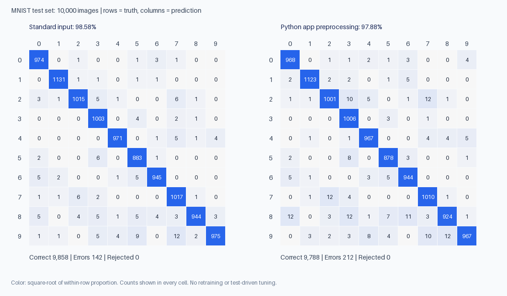
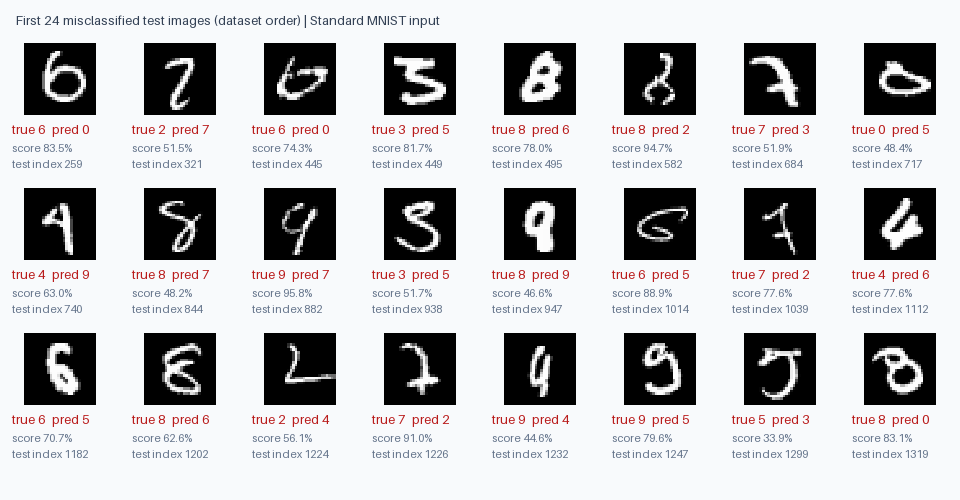

# 已保存模型的准确率复测

本报告由 `evaluate.py` 生成，不重新训练，也不根据测试结果选择或修改权重。

## 评估范围

- 数据：官方 MNIST 测试集，完整 10,000 张图片。
- 标准输入：直接使用 MNIST 的 28×28 灰度图片，像素除以 255 后使用 mean=0.1307、std=0.3081 标准化。
- Python 画板流程：同一批图片先经过 `predict.py` 的极性统一、裁剪、等比缩放和重心居中，再送进同一模型。
- 推理使用 `eval()` 和 `inference_mode()`；所有样本都计入准确率分母，预处理拒绝也算未识别正确。
- 这是已用于第一次报告的同一测试集上的复测，不是一份新收集的独立保留集。
- 画板流程结果只衡量对 MNIST 图片重复预处理后的影响，不能当作真实用户笔迹或手机照片的准确率。浏览器版的插值实现还可能与 Pillow 不同。

模型：`mnist_cnn.pt`；SHA-256：`6b668995064b93281563d2babd18eceb7f99a4feec9e543224d095dbcd5cc6d1`。

软件：PyTorch 2.15.0；评估设备：cpu。

## 总体结果

| 指标 | 标准 MNIST 输入 | Python 画板预处理 |
| --- | ---: | ---: |
| 准确率 | **98.58%** | **97.88%** |
| 识别正确 | 9,858 / 10,000 | 9,788 / 10,000 |
| 识别错误或拒绝 | 142 | 212 |
| 预处理拒绝 | 0 | 0 |
| Macro F1 | 0.9856 | 0.9786 |
| 交叉熵损失（接受的输入） | 0.040196 | 0.063514 |
| 准确率 95% Wilson 区间 | 98.33%～98.79% | 97.58%～98.14% |

Wilson 区间描述二项抽样不确定性；不覆盖数据分布变化、训练随机性或测试集被反复查看的影响。

重复预处理相对标准输入改变了 **-0.70 个百分点**。

## 部署版 JavaScript 预处理复测

使用 Node.js 执行网页实际使用的 `docs/preprocess.js`，对同一批 10,000 张 MNIST 图片进行处理，然后交给同一个 PyTorch CPU 模型推理。
这验证了部署版的像素预处理路径；不是浏览器 WASM 的端到端准确率测量，也不包含浏览器的图片解码、上传缩图或实际用户笔迹。

- 准确率：**97.88%（9,788 / 10,000）**；错误或拒绝 212 张，预处理拒绝 0 张。
- Macro F1：0.9786；95% Wilson 区间：97.58%～98.14%。
- 预处理源码 SHA-256：`8a62b90f059ce8f6f49267fe5dd0f7fdbcc2633d69d806a33e376496f4d98297`；Node.js v24.15.0。

| 数字 | JS 预处理 Recall |
| --- | ---: |
| 0 | 98.78% |
| 1 | 98.94% |
| 2 | 97.00% |
| 3 | 99.60% |
| 4 | 98.47% |
| 5 | 98.43% |
| 6 | 98.54% |
| 7 | 98.25% |
| 8 | 94.87% |
| 9 | 95.84% |

## 各数字表现

Precision：预测为这个数字的图片中，实际正确的比例。Recall：实际属于这个数字的图片中，被正确认出的比例。F1：两者的调和平均。

| 数字 | 样本数 | 标准 Precision | 标准 Recall | 标准 F1 | 画板 Recall |
| --- | ---: | ---: | ---: | ---: | ---: |
| 0 | 980 | 98.28% | 99.39% | 0.9883 | 98.78% |
| 1 | 1135 | 99.56% | 99.65% | 0.9960 | 98.94% |
| 2 | 1032 | 98.83% | 98.35% | 0.9859 | 97.00% |
| 3 | 1010 | 97.66% | 99.31% | 0.9848 | 99.60% |
| 4 | 982 | 99.28% | 98.88% | 0.9908 | 98.47% |
| 5 | 892 | 97.25% | 98.99% | 0.9811 | 98.43% |
| 6 | 958 | 98.95% | 98.64% | 0.9880 | 98.54% |
| 7 | 1028 | 97.23% | 98.93% | 0.9807 | 98.25% |
| 8 | 974 | 99.37% | 96.92% | 0.9813 | 94.87% |
| 9 | 1009 | 99.29% | 96.63% | 0.9794 | 95.84% |

## 最常见的混淆

| 真实数字 → 预测数字 | 标准输入次数 |
| --- | ---: |
| 9 → 7 | 12 |
| 9 → 5 | 9 |
| 2 → 7 | 6 |
| 5 → 3 | 6 |
| 7 → 2 | 6 |
| 2 → 3 | 5 |
| 4 → 7 | 5 |
| 6 → 0 | 5 |
| 6 → 5 | 5 |
| 8 → 0 | 5 |



下面按测试集原始顺序展示前 24 个错误，没有挑选最容易或最难的例子。置信分数高也可能识别错误。



## 复现

在项目根目录运行（完整复测额外需要 Node.js）：

```bash
.venv/bin/python evaluate.py --device cpu --include-browser
```

省略 `--include-browser` 时只评估 Python 的两条路径，不需要 Node.js。

首次运行如本地缺少数据会下载官方 MNIST 数据；已有缓存时不需要重新下载。详细逐类指标、完整混淆矩阵、错误索引和模型校验值保存在 `evaluation.json`。
